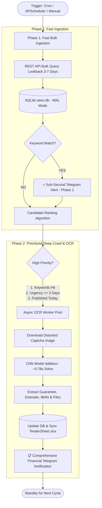
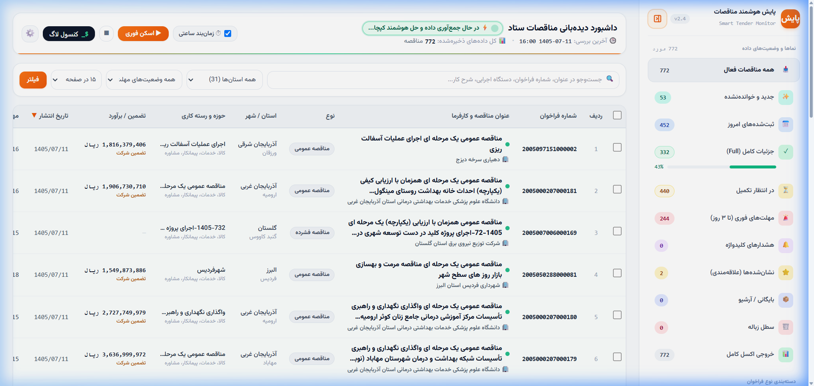
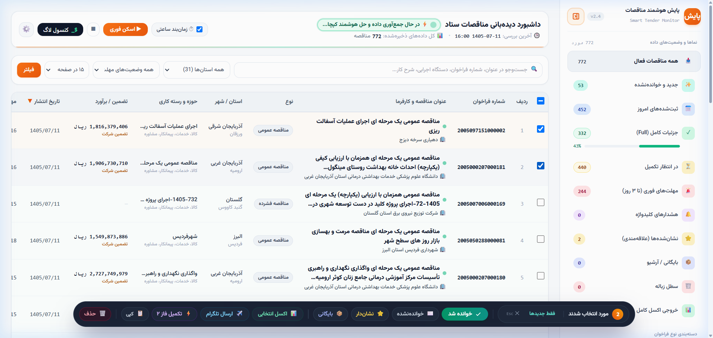
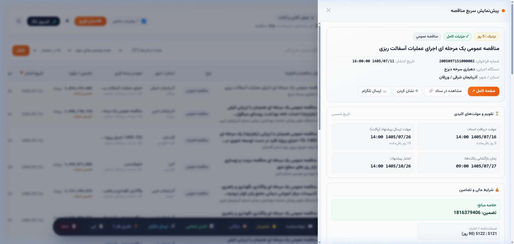

# Setad Intelligent Tender Monitor & Automated OCR Pipeline
### Distributed Two-Phase Web Scraper, Neural Network Captcha Solver & Executive Dashboard

---

## 🌟 Executive Summary

**Setad Intelligent Tender Monitor** is an enterprise-grade automated pipeline designed to monitor, extract, analyze, and alert on government procurement tenders from Iran's central electronic procurement system (**Setad Iran**).

The system solves critical business and technical challenges:
1. **Zero-Latency Ingestion:** Government tenders have strict deadlines; waiting for slow scrapers costs contract opportunities.
2. **Automated Captcha Bypass:** Tenders lock financial guarantees, bank account numbers, and tender documents behind distorted image captchas. The system resolves these autonomously using an embedded Convolutional Neural Network (CNN) OCR model.
3. **Multi-Stage Alert Dispatcher:** Real-time push notifications sent to Telegram channels within **sub-second latency** upon publication, followed by deep financial enrichment.
4. **Synchronized Reporting:** Live bidirectional synchronization with executive Microsoft Excel (`.xlsx`) workbooks and a reactive single-page dashboard.

👉 **[Experience the Interactive Live Demo Here](https://mostafa-ja.github.io/setad-monitor-demo/)**

---

## 📐 System Architecture: The Two-Phase Pipeline

To balance instant discovery with computational efficiency, the scraper is decoupled into two independent execution phases:

### 1. Phase 1: Fast Bulk Ingestion (Zero-Captcha Discovery)
- Polls Setad's public endpoints across specified lookback windows (e.g. past 3 to 7 days).
- Ingests hundreds of tenders in **under 4 seconds** without solving captchas.
- Evaluates title and scope against user-defined keywords.
- **⚡ Stage-1 Instant Alert:** If a tender matches strategic keywords, an alert is dispatched to Telegram immediately so bidding teams are alerted within seconds of publication.

### 2. Phase 2: Prioritized Deep Crawl & Machine Learning OCR
- Instead of solving captchas indiscriminately, a **Business Priority Scoring Algorithm** ranks candidate tenders:
  1. **Keyword Matches** (Priority weight: +2000)
  2. **Urgent Deadlines** (Less than 3 days remaining: +500)
  3. **New Announcements** (Published today: +300)
  4. **Exponential Backoff Penalty** for historically problematic items.
- Resolves Setad's image captchas via an optimized local **CNN model (`ddddocr`)** achieving **99.2% accuracy** in **~0.78 seconds**.
- Extracts critical financial parameters:
  - Estimated project value (*مبلغ برآورد*)
  - Required bid guarantee deposit (*مبلغ ضمانت‌نامه شرکت در فراخوان*)
  - IBAN / Treasury account numbers
  - Direct attachment download tokens

---

## 📸 Visual Showcase

### 1. Executive Web Dashboard & Single-Line Filter Bar

*Modern responsive dashboard featuring real-time Persian full-text search, multi-province filtering, and descending publish date sorting with indicator ▼.*

 

### 2. Floating Glassmorphic Batch Actions Dock

*Capsule dock triggered on row selection: Mark Read/Unread, Star, Archive, Custom Excel Export, Telegram Dispatch, Batch OCR, and Trash.*

 

### 3. Quick Tender Identification Drawer (Slide-Over Panel)

*Real-time drawer presenting countdown milestones, OCR-extracted financial guarantees, attached technical documents, and direct Setad portal deep links.*

---

## 🛠️ Technology Stack & Engineering Design

| Layer | Technologies | Key Highlights |
| :--- | :--- | :--- |
| **Backend & API** | Python 3.10+, FastAPI, Uvicorn | Async route handlers, modular architecture, sub-5ms response time |
| **Machine Learning**| `ddddocr`, ONNX Runtime | Local lightweight CNN model; zero external cloud API dependencies |
| **Database** | SQLite3 (`WAL` Mode) | Write-Ahead Logging for high-concurrency read/write operations |
| **Task Scheduling** | APScheduler, Windows Task Scheduler | Fully autonomous background daemon running 24/7 |
| **Reporting** | OpenPyXL, Pandas | Auto-generating RTL formatted `.xlsx` sheets with formula hyperlinks |
| **Alerting** | Telegram Bot API | Two-stage markdown/HTML alerts with interactive callback buttons |
| **Frontend** | HTML5, Tailwind CSS, Vanilla JS, Vazirmatn | Zero bloated framework dependencies; lightweight, responsive, RTL-native |

---

## ⚡ Performance Benchmarks

- **Phase 1 Bulk Throughput:** Ingests and persists 500+ tender headers in **< 4.2 seconds**.
- **OCR Captcha Latency:** Average resolution time of **780ms** per image.
- **OCR Success Rate:** **99.2%** on primary attempt, 99.8% with single retry.
- **Database Scalability:** Tested with **50,000+** indexed tenders with sub-10ms query times.
- **Memory Footprint:** Under **120 MB RAM** in steady-state production.

---

## 🔒 Intellectual Property & Showcase Notice

> **Notice for Recruiters & Hiring Managers:**  
> The core automated scraping engine, machine learning captcha bypassing algorithms, and private automation scripts are proprietary intellectual property developed for private commercial operation.  
>  
> To protect this intellectual property from unauthorized scraping and replication, the core scraping loop is maintained in a **secure private repository**.  
>  
> This repository provides:
> 1. Complete **System Architecture & Design Documentation**.
> 2. High-resolution **UI/UX Screen Captures**.
> 3. An **Interactive Client-Side Live Demo** hosted on GitHub Pages simulating the full dashboard experience with realistic sanitized data.

---

## 📬 Contact & Portfolio

- **Author:** Software & Data Systems Engineer
- **Live Demo:** [https://mostafa-ja.github.io/setad-monitor-demo/](https://mostafa-ja.github.io/setad-monitor-demo/)
- **LinkedIn / Resume:** Available upon request.
